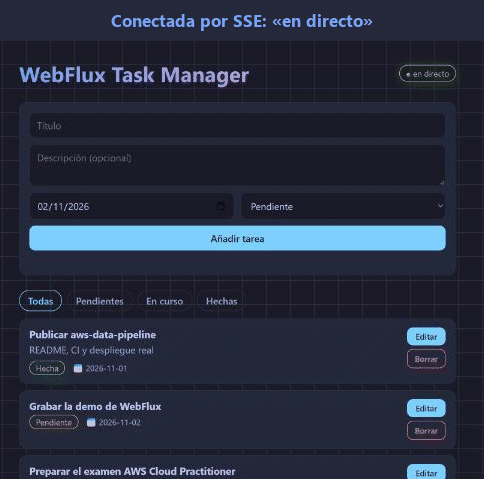
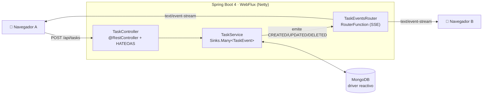
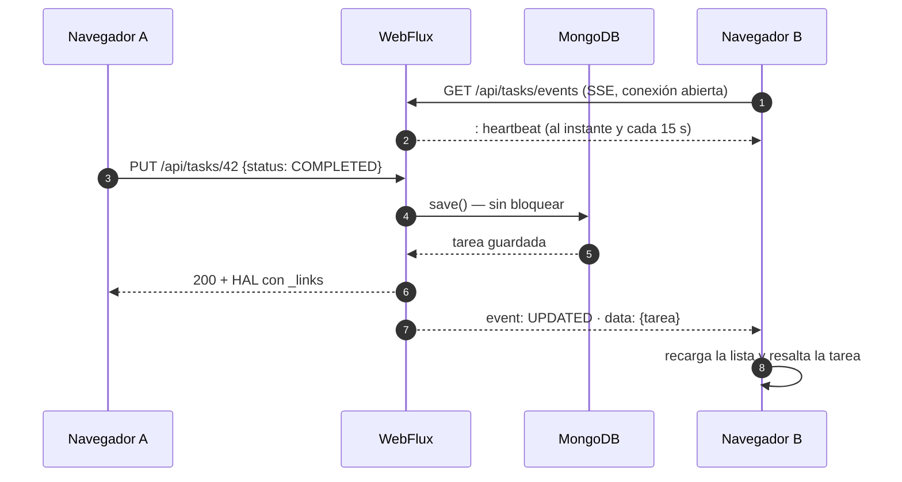

<p align="center">
  
</p>

<p align="center">
  <a href="https://github.com/AlbaAsca/WebFluxTaskManager/actions/workflows/ci.yml"></a>
  
  
  
  
  
</p>

<p align="center">
  <b>Una API REST reactiva de tareas, de las que no bloquean ni un hilo.</b><br>
  HATEOAS para navegar la API sin construir URLs · errores RFC 9457 · cambios en tiempo real por Server-Sent Events.
</p>

> 🇬🇧 **In English:** a reactive task API built with Java 21, Spring Boot 4 and Spring WebFlux on reactive MongoDB.
> HAL/HATEOAS responses, RFC 9457 problem details, HTTP Basic with role-based access, and real-time change
> events streamed over Server-Sent Events to every connected browser. Tested with WebFlux slices, StepVerifier
> and an end-to-end Testcontainers suite against a real MongoDB in CI.

## Qué hace

Una lista de tareas compartida. Cuando alguien crea, edita o borra una tarea, **todas las pestañas abiertas
se actualizan al instante**, sin recargar: el servidor empuja el cambio por Server-Sent Events.

<p align="center">
  
</p>

| | |
|---|---|
| **Reactivo de punta a punta** | Netty + WebFlux + driver reactivo de MongoDB: ninguna petición bloquea un hilo esperando a la base de datos |
| **Tiempo real** | Cada alta, cambio o borrado se publica en un `Sinks.Many` y se difunde por SSE a todos los clientes |
| **API navegable (HATEOAS)** | Cada tarea trae sus enlaces `self`, `update`, `delete`; el frontend usa esos enlaces, no URLs escritas a mano |
| **Errores estándar** | `application/problem+json` (RFC 9457), con el detalle de cada campo inválido |
| **Seguridad por roles** | HTTP Basic: `USER` lee, crea y edita; solo `ADMIN` borra. Usuarios por configuración, nunca en el código |
| **Documentada** | OpenAPI + Swagger UI en `/swagger-ui.html` |

## Arquitectura



Las dos formas de programar WebFlux conviven a propósito: **`@RestController`** para el CRUD y una
**`RouterFunction`** funcional para el flujo de eventos.

### Un cambio, de principio a fin



## La API

| Método | Ruta | Rol | Respuesta |
|---|---|---|---|
| `GET` | `/api/tasks?status=PENDING` | USER | Colección HAL ordenada por fecha límite |
| `GET` | `/api/tasks/{id}` | USER | Tarea con enlaces, o `404` problem+json |
| `POST` | `/api/tasks` | USER | `201` + `Location` |
| `PUT` | `/api/tasks/{id}` | USER | Tarea modificada |
| `DELETE` | `/api/tasks/{id}` | **ADMIN** | `204` (un USER recibe `403`) |
| `GET` | `/api/tasks/events` | USER | `text/event-stream`: `CREATED` · `UPDATED` · `DELETED` |

<details>
<summary>Ejemplo de respuesta HAL</summary>

```json
{
  "id": "6725...",
  "title": "Preparar el examen",
  "status": "IN_PROGRESS",
  "dueDate": "2026-11-30",
  "createdAt": "2026-11-01T20:41:03Z",
  "_links": {
    "self":   { "href": "http://localhost:8080/api/tasks/6725..." },
    "update": { "href": "http://localhost:8080/api/tasks/6725..." },
    "delete": { "href": "http://localhost:8080/api/tasks/6725..." },
    "tasks":  { "href": "http://localhost:8080/api/tasks" }
  }
}
```
</details>

<details>
<summary>Ejemplo de error (RFC 9457)</summary>

```json
{
  "type": "about:blank",
  "title": "Datos no válidos",
  "status": 400,
  "detail": "La tarea no es válida",
  "errors": { "title": "El título es obligatorio", "dueDate": "La fecha límite es obligatoria" }
}
```
</details>

## Cómo ejecutarlo

Necesitas Java 21 y Docker.

```bash
./mvnw spring-boot:run          # levanta MongoDB con Docker Compose y la aplicación
```

Abre <http://localhost:8080> en **dos ventanas** y cambia una tarea en una: la otra se actualiza sola.
Usuarios de demo: `user` / `user` y `admin` / `admin` (cámbialos con `APP_USER_PASSWORD` y `APP_ADMIN_PASSWORD`).

| Otras formas | |
|---|---|
| Todo en contenedores | `docker compose --profile app up --build` |
| Con MongoDB Atlas u otro | `MONGODB_URI=mongodb+srv://... ./mvnw spring-boot:run` |
| Swagger UI | <http://localhost:8080/swagger-ui.html> |
| Probar el tiempo real con curl | `curl -N -u user:user localhost:8080/api/tasks/events` |

## Tests

```bash
./mvnw verify
```

| Capa | Cómo | Qué comprueba |
|---|---|---|
| Web | `@WebFluxTest` + `WebTestClient` | enlaces HAL, filtro por estado, 404 y 400 en RFC 9457, `Location`, 401 sin usuario, 403 si un USER borra |
| Servicio | `StepVerifier` + Mockito | que cada cambio emite su evento, que una modificación conserva id y fechas |
| De punta a punta | `@SpringBootTest` + **Testcontainers** (MongoDB real) | ciclo completo alta → cambio → filtro → borrado, y que el flujo SSE recibe `CREATED`, `UPDATED`, `DELETED` |

El test de integración se salta solo si la máquina no tiene Docker; en el CI de GitHub Actions corre siempre.

## Decisiones y su porqué

- **`record` inmutable para la tarea.** Modificar es crear una copia (`withContent`), así no hay estado compartido
  mutable en un código donde varias peticiones se ejecutan a la vez en pocos hilos.
- **`Sinks.many().multicast().directBestEffort()`.** Cada cliente recibe los cambios desde que se conecta y uno lento
  no frena a los demás. Para varias instancias habría que pasar a MongoDB Change Streams o un broker.
- **Latido SSE inmediato y cada 15 s.** Sin el primero, el cliente no recibe las cabeceras hasta el primer cambio
  (lo detectó el test de integración); los siguientes evitan que un proxy cierre la conexión por inactividad.
- **DTO de entrada separado (`TaskRequest`).** El cliente nunca puede fijar `id` ni las fechas de auditoría.
- **MongoDB 7.0 en tests y Compose.** En 2026, MongoDB 8.x se niega a arrancar en kernels Linux 6.19+
  ([SERVER-121912](https://jira.mongodb.org/browse/SERVER-121912)), que es lo que usan los runners de GitHub.
  Lo descubrió el CI leyendo los logs del contenedor.
- **HTTP Basic y no JWT.** La versión anterior traía un `JwtUtil` que nadie usaba y con una clave nueva en cada
  arranque; mejor quitarlo que aparentar.

## Historia

Empezó en 2024 como proyecto para aprender WebFlux (Spring Boot 3.4 *snapshot*, Java 22, MongoDB Atlas). En
noviembre de 2026 lo modernicé: Java 21 LTS, Spring Boot 4.1 estable, HATEOAS, errores estándar, eventos SSE reales
(antes se generaban tareas falsas cada 10 s), seguridad configurable, Testcontainers, Docker y CI.

## Licencia

MIT.
